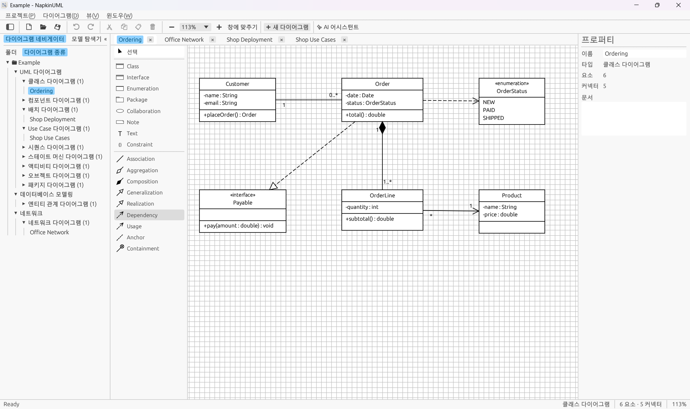

# NapkinUML

NapkinUML은 개인적으로 사용하려고 생성한 UML 다이어그램 에디터입니다. 복잡하거나 화려하거나 특별한 기능 없이 간단하게 그릴 목적으로 만들었습니다.

## 지원 다이어그램

UML 9종:
* 클래스 다이어그램
* 컴포넌트 다이어그램
* 배치 다이어그램
* Use Case 다이어그램
* 시퀀스 다이어그램
* 스테이트 머신 다이어그램
* 액티비티 다이어그램
* 오브젝트 다이어그램
* 패키지 다이어그램

기타 2종:
* ER 다이어그램
* 네트워크 다이어그램

## 실험 기능: AI 어시스턴스
로컬에 설치한 AI 에이전트를 이용해서 다이어그램 제작을 도움 받을 수 있습니다.

AI 에이전트(Claude Code, Codex CLI, Gemini CLI, Ollama 등)는 NapkinUML에 포함되어 있지 않습니다. 사용자가 직접 설치한 프로그램을 실행하며, 각 프로그램의 라이선스와 이용 약관을 따릅니다.

## 라이선스

NapkinUML의 소스 코드는 다음 두 라이선스 중 하나를 선택해 사용할 수 있습니다.

* [Apache License 2.0](LICENSE-APACHE)
* [MIT License](LICENSE-MIT)

NapkinUML 이름, 로고와 아이콘(`icons/`, `docs/`의 이미지)은 위 라이선스에 포함되지 않습니다. 수정한 버전을 배포할 때는 다른 이름과 아이콘을 사용해 주세요.

### 서드파티 오픈소스

NapkinUML은 egui, winit, serde, image, rfd 등 오픈소스 Rust 크레이트를 사용하며, 배포 파일에는 egui에 내장된 폰트(Hack, Ubuntu, Noto Emoji 등, SIL OFL 1.1 및 Ubuntu Font Licence)가 포함됩니다. 의존성 목록과 라이선스 전문은 릴리즈에 함께 올라가는 `THIRD-PARTY-LICENSES.html`(macOS 앱은 `NapkinUML.app/Contents/Resources/` 안)에서 확인할 수 있습니다.

새 의존성은 허용 라이선스(MIT, Apache-2.0, BSD, ISC, Zlib 등 비 카피레프트)만 사용할 수 있으며, `deny.toml`에 정의된 정책을 CI에서 `cargo deny check licenses`로 검사합니다.
