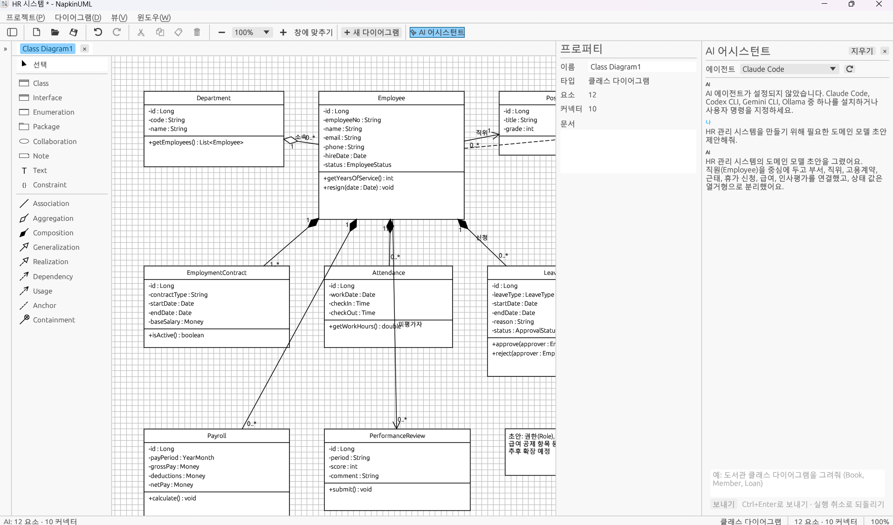

# NapkinUML

NapkinUML은 개인적으로 사용하려고 생성한 UML 다이어그램 에디터입니다. 복잡하거나 화려하거나 특별한 기능 없이 간단하게 그릴 목적으로 만들었습니다.

## 지원 다이어그램

UML 9종:
* 클래스 다이어그램
* 컴포넌트 다이어그램
* 배치 다이어그램
* Use Case 다이어그램
* 시퀀스 다이어그램
* 스테이트 머신 다이어그램
* 액티비티 다이어그램
* 오브젝트 다이어그램
* 패키지 다이어그램

기타 2종:
* ER 다이어그램
* 네트워크 다이어그램

## 실험 기능: AI 어시스턴스
로컬에 설치한 AI 에이전트를 이용해서 다이어그램 제작을 도움 받을 수 있습니다.

